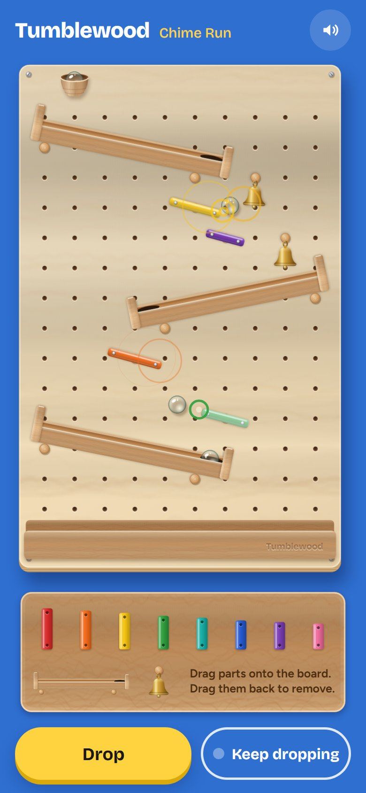

# Tumblewood

A wooden marble run you build on a pegboard, and hear.

**[Try it](https://michaelshadpour.com/try/tumblewood)** · [Read the write-up](https://michaelshadpour.com/work/tumblewood)




## What it is

The product page for a fictional toy maker's marble run, the Chime Run, where the page is the toy. You hang beech ramps, enamel chimes and brass bells on a pegboard and drop glass marbles. Every marble that hits a chime plays a note, so the run you build is a tune, and the kit list and price follow whatever you built.

What to try:

- Tap Drop and listen, then move a chime.
- Drag any ramp, chime or bell to another peg. It settles on the nearest peg where it fits. Tap a ramp or a chime to turn it the other way, and tap a bell to ring it.
- Drag new parts onto the board from the tray, and drag parts back to the tray to take them off. Drag the cup along the top edge to move the drop point.
- "Keep dropping" drops a marble every 1.6 seconds. The speaker button turns the sound off and on. Sound starts with your first tap.
- The run is kept in the address as you build (`?run=...`), so reloading keeps it and "Copy a link to this run" shares it. "Start over" brings back the starter run.
- "Order this kit" is a demo: nothing is charged or sent.
- Add `?attract=1` to the address for a self-running demo mode: a silent 12 second loop in which the page plays the starter run, moves a chime, turns a ramp and puts both back. The first tap on the board, or any key press, hands it over to you.

## How it works

Lengths below are in peg pitches. One pitch is the distance between two neighboring pegs.

- **Physics written for this toy.** Marbles are circles against capsules (ramps, chime bars, bell lips) and circles (bell domes). Each 1/240 s step sweeps the marble along its motion and stops at the first contact, so nothing tunnels: a unit test fires a marble at 600 pitches per second into a thin chime and it still bounces. Every material has its own restitution, friction and rolling resistance (beech is dull, aluminum rings), and rolling is real spin: a test checks that a marble on 8, 15 and 25 degree slopes reaches the speed of a rolling solid sphere (5/7 of the sliding acceleration) within 2 percent, with its spin matching its speed.
- **Energy can only go down.** Contacts only ever remove energy, and a guard takes back the tiny gain a fixed step can produce when a marble is wedged between two surfaces. Tested step by step on the starter run and on twelve random boards.
- **Deterministic, so the run is a tune.** Plain arithmetic in a fixed order and drops on exact step counts: the same board and the same drops give the same hits every time (tested on 20 seconds of drops, compared exactly). The self-running demo is a 12 second script keyed to simulation steps. A test checks that a cycle ends where it began to within a millionth of a peg pitch, so the loop has no jump.
- **Sound is synthesized, tuned and physical.** Each chime is a struck free-free bar: the fundamental plus the bar's real overtones at 2.756, 5.404 and 8.933 times it, each dying faster than the one below, louder and brighter the harder the marble hits. The eight chimes are tuned to a C major pentatonic scale (C5 to E6), so any run stays in key, and each bar is drawn at the length a real bar needs for its note (length goes as one over the square root of pitch). Bells, wooden knocks, the tray, glass on glass and the rolling rumble are built from oscillators and filtered noise. The room is a convolution reverb made from shaped noise. No audio files.
- **The board is data.** A run is a short string, three characters per piece (`?run=u1r01l46...`), kept in the URL as you build, so reloading keeps your run and a link shares it. Bad links fall back to the starter run, and overlapping pieces in a link are dropped. Placement rules (in bounds, no overlap, nearest good peg) and the kit count and price are unit-tested.
- **The starter run was found, not guessed.** `scripts/search.ts` hill-climbs chime and bell positions, and scores a layout higher when its phrase stays the same as the drop point moves by a few hundredths of a pitch. `scripts/attract-search.ts` found the chime move and the ramp flip that the self-running demo performs. Both are plain TypeScript that Node runs directly, with no build step: `node scripts/search.ts` and `node scripts/attract-search.ts`. That needs Node 22.18 or newer.
- **Known limits.** Checked in Chromium only. The end-to-end tests check that sound starts only after the first tap and that nothing is logged as an error, not how it sounds. Pieces snap to pegs and cannot overlap, but a run can still jam: a marble can come to rest wedged under a chime placed too low. That is left as it is: a real marble run can jam too. There is no keyboard way to move pieces on the board. Drop, Keep dropping, the sound button and the page controls are keyboard accessible. The tray keeps the last four marbles, and older ones fade back into the bag.

## Stack

Vite 6 and TypeScript (strict), no framework. Canvas 2D for the toy, the Web Audio API for every sound, plain DOM for the page. Vitest for unit tests, Playwright (Chromium) for end-to-end tests. No runtime dependencies besides two self-hosted fonts.

## Run it

```
npm install
npm run dev          # http://127.0.0.1:5314
npm test             # Vitest: physics, board rules, the self-running demo loop
npm run build        # type check, then dist/ with relative paths, so it works from any subpath
npm run preview      # serves the folder at http://127.0.0.1:5414 (build first, then open /dist/)
```

For the end-to-end tests:

```
npx playwright install chromium
npm run test:e2e     # builds, then runs Playwright on dist/ at 390 x 844 (touch) and 1440 x 900
```

If Playwright's own Chromium cannot be downloaded, set `CHROMIUM_PATH` to a Chromium that is already installed.

## Layout

- `src/`: `main.ts` (start-up, the kit list, the buttons), `app.ts` (the toy: layout, drawing, input), `attract.ts` (the script of the self-running demo mode) and the two product photographs in `assets/`.
- `src/sim/`: the marble physics, and a run (a board, its world and the drops).
- `src/board/`: pieces, placement rules, the link format, the kit and price, and the starter run.
- `src/audio/`: every sound, made with the Web Audio API.
- `src/render/`: everything on the board, drawn on canvas.
- `tests/`: Vitest unit tests. `e2e/`: Playwright end-to-end tests.
- `scripts/`: `serve.mjs` (the static server behind `npm run preview` and the end-to-end tests), `browser.mjs` (picks the Chromium they run in), and the two searches.
- `docs/`: the screenshots in this README.

## Credits and license

- Fonts: Bricolage Grotesque Variable (headings, wordmark) and Figtree Variable (text), from `@fontsource-variable`, SIL Open Font License 1.1. Latin subset, weight axis only, loaded from the build.
- Pictures: the two product photographs, `src/assets/tumblewood-parts.webp` (in "What is in your kit") and `src/assets/tumblewood-kit.webp` (in "Order this kit"), were generated with ChatGPT for this project. They are the only images that are not drawn in code. The toy itself (board, ramps, chimes, bells, marbles, tray, cup) is drawn on canvas, and the favicon is hand-written SVG.
- Concept project. Tumblewood is a fictional brand.
- Design and build: [Michael Shadpour](https://michaelshadpour.com).
- The code is under the MIT license. See [LICENSE](LICENSE).
